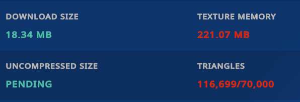
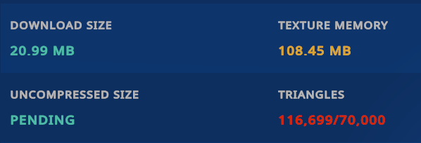
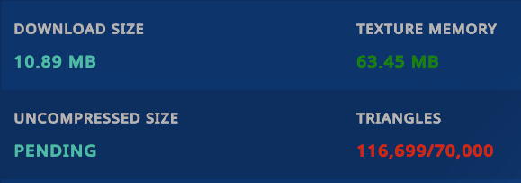
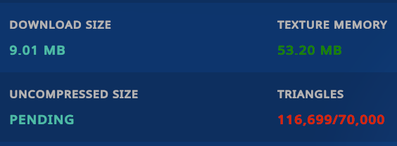

**English** | [ไทย](README.th.md) | [简体中文](README.zh-Hans.md)

# AvatarTuner

Texture memory optimization for VRChat avatars, inside the Unity Editor. AvatarTuner analyzes
an avatar's textures, plans safe format/resolution changes, generates optimized copies, and
applies them to the avatar's own material references — without ever touching your original
assets.

AvatarTuner optimizes **texture assets and material references**. It does not reduce mesh
triangles, does not merge meshes or materials, and does not resolve every VRChat performance
warning.

## What it does

1. Scan an avatar: textures, materials, renderers, animation-driven material swaps, and
   third-party tool usage (Modular Avatar, VRCFury, NDMF, Avatar Optimizer,
   d4rkAvatarOptimizer).
2. Plan: per-texture decisions from a preset policy — protected textures (third-party tools,
   animation-driven systems) are never touched.
3. Optimize: generate optimized texture copies into `Assets/AvatarTuner-Generated/`.
4. Apply: assign optimized material clones to the scene avatar's renderers (Undo-recorded,
   prefab-override aware), with material-swap animations remapped onto generated clip and
   controller copies.

Original source textures, materials, prefabs, animations and animator controllers are never
modified.

## Key features

- Three optimization presets with honest trade-off descriptions (see below).
- Direct scene application: the avatar in the scene really references the optimized
  materials; you can inspect them in the Inspector before any build.
- Automatic change detection: reverting a material, adding an unoptimized renderer, or
  editing sources is detected and reported (Changes Detected / Re-optimization Required).
- One-click restore of the original material references.
- Optional build-time application through NDMF (when installed) for users who prefer
  keeping the scene untouched.
- Per-texture overrides: exclude, keep resolution, keep format, force max size, force format.
- Localization: English, Thai (ไทย) and Simplified Chinese (简体中文), switchable live.
- Full transparency: estimates are always labelled as computed estimates; nothing is
  presented as a measurement unless it was measured.

## Compatibility

- **Unity 2022.3** (verified on 2022.3.22f1).
- VRChat SDK avatars (Avatars 3.0). AvatarTuner has no compile-time dependency on the
  VRChat SDK.
- Optional: **NDMF** (`nadena.dev.ndmf`) enables the build-time application pass. Without
  NDMF, direct scene application remains fully functional.
- Known optimizers (AAO / d4rkAvatarOptimizer) are detected; conflicting transformations
  are skipped with an actionable warning instead of racing them.

## Installation

### Option 1: VRChat Creator Companion (Recommended)

The easiest way to install and keep AvatarTuner updated automatically.

[**➕ Add to VCC (One-Click Install)**](vcc://vpm/addRepo?url=https%3A%2F%2Fawakenginexe.github.io%2FAvatarTuner%2Findex.json)

#### Or Add Repository Manually:
1. Copy the VPM repository URL:
   ```text
   https://awakenginexe.github.io/AvatarTuner/index.json
   ```
2. In VCC, open **Settings → Packages**.
3. Click **Add Repository** in the top right.
4. Paste the URL and confirm.
5. Open your project, go to **Manage Packages**, find **AvatarTuner**, and click **Install**.

> [!TIP]
> **Updating:** When a new version is released, VCC will display an **Update** button next to AvatarTuner under **Manage Packages**.

> [!NOTE]
> **Switching from a previous .unitypackage install:** If you previously installed AvatarTuner via `.unitypackage`, verify you have no personal assets or custom modifications in `Assets/AvatarTuner/`, then delete `Assets/AvatarTuner/` (and its `.meta` file) before adding the package via VCC to avoid duplicate file conflicts. Existing avatar references and generated assets remain unaffected.

---

### Option 2: Unity Package (.unitypackage)

If you prefer not using VCC:

1. Download the latest **`AvatarTuner-v1.0.0.unitypackage`** from [GitHub Releases](https://github.com/awakenginexe/AvatarTuner/releases/latest).
2. In your Unity project, go to **Assets → Import Package → Custom Package…** and select the file.
3. Open the window via **Tools → AvatarTuner**.

---

### Option 3: Unity Package Manager (Git URL)

1. In Unity, open **Window → Package Manager**.
2. Click the **`+`** icon in the top left and select **Add package from git URL…**.
3. Paste:
   ```text
   https://github.com/awakenginexe/AvatarTuner.git
   ```

---

The package contains: `Core/` (pure logic), `Editor/` (window, scanner, optimizer,
tracking, application, NDMF integration), `Editor/Localization/Translations/` (three
languages), `package.json`, and the assembly definitions.

## Quick start

1. Open **Tools → AvatarTuner**.
2. Drag your avatar root from the Hierarchy into the avatar area (or use the picker).
3. Click **Analyze Avatar**.
4. Click **Optimize Avatar** → the configuration dialog opens: choose a preset, review the
   planned changes, then **Confirm & Optimize**.
5. The optimized textures are generated and applied to the scene avatar. The Overview shows
   the honest status (e.g. *Optimized and Applied to Avatar*) and the memory numbers with
   their basis (computed vs measured).
6. Changed your mind? **Restore Original Textures** on the Optimization Results page
   reverts the material references (generated files are kept).

## Optimization presets

| Preset | Behaviour |
| ------ | --------- |
| **Quality First** | Visual fidelity first. Resolution is never reduced; only changes that should be visually invisible are allowed. |
| **Balanced** (default, recommended) | A middle ground: meaningful texture-memory reduction while keeping differences hard to see (one resolution step down, never below 1024). |
| **Size First** | Maximum memory reduction first; visible quality loss is possible. Review the affected textures individually before uploading. |

## Screenshots

Measured with VRChat's own Performance Breakdown on the same avatar (same pose, same mesh —
116,699 triangles in every capture; AvatarTuner changes no meshes).

### Original



### Quality First



### Balanced



### Size First



## Performance and size comparison

Measured on the same avatar with VRChat's Performance Breakdown (values are exactly as
displayed by VRChat):

| Preset | VRChat Texture Memory (MB) | VRChat Download Size (MB) | Texture Memory Reduction | Download Size Reduction | Visual quality notes |
| ------ | --- | --- | --- | --- | -------------------- |
| Original | 221.07 | 18.34 | — | — | Baseline |
| Quality First | 108.45 | 20.99 | 50.9 % | −14.4 % (larger) | Resolution untouched; download size can grow slightly because quality-preserving formats are less aggressively compressed |
| Balanced | 63.45 | 10.89 | 71.3 % | 40.6 % | Differences hard to see in normal use |
| Size First | 53.20 | 9.01 | 75.9 % | 50.9 % | Largest reduction; visual differences not separately evaluated — review flagged textures before uploading |

Reduction formula, computed independently per column:
`Reduction (%) = (Original − Optimized) / Original × 100`.

Results vary with the model, its textures, shaders and settings. These numbers are from one
real avatar and are not a promise for any other avatar.

### About the measurement difference between AvatarTuner and VRChat

AvatarTuner calculates texture memory from asset data and optimization settings. These
values are estimates and may differ from VRChat's Performance Breakdown due to
platform-specific texture formats, mipmaps, compression, asset references, and build-time
processing. Download size and GPU texture memory are different measurements. For the most
accurate comparison, check the actual avatar build in VRChat.

In detail:

- AvatarTuner computes GPU texture memory from texture dimensions, formats, mipmap chains
  and the optimization data it actually processed.
- VRChat reports from its own analysis of the built avatar in its own build/runtime
  environment.
- Platform overrides, compression formats, mipmaps, animated or additional material
  references, and other build-time optimization tools can all change the final numbers.
- The Editor's computed GPU texture memory is **not** the same thing as download size.
- The disk size of the generated texture assets is **not** the same thing as VRChat texture
  memory.
- Only real VRChat measurements (like the table above) are presented as VRChat results;
  AvatarTuner's in-Editor values stay labelled as computed estimates.

## Known limitations

- Direct application requires the avatar to be a **scene object** (a prefab instance in the
  scene is fine); selecting a prefab asset from the Project window generates outputs without
  applying them (applying would modify the source asset).
- Material-swap animations are remapped onto generated clip/controller copies when the clip
  and controller are real assets. References that cannot be remapped safely keep the original
  assets and the avatar is marked **Partially Optimized** — never silently skipped.
- Detected optimizer conflicts (AAO / d4rkAvatarOptimizer components on the avatar) skip the
  conflicting transformation with a warning.
- Change detection runs on selection, window open, refresh, analysis and optimization — not
  on every editor frame.
- AvatarTuner does not reduce triangle counts, mesh counts or material slot counts.

## Restoring the original textures

Optimization Results → **Restore Original Textures**. Every renderer slot returns to its
original material, and animators return to their original controllers (Undo-recorded;
generated files are kept for a later re-application). Your original assets were never
modified, so a full cleanup is also possible via **Clean Up Generated Files**.

## Safety guarantees

- Original textures, materials, prefabs, animations and controllers are never modified.
- Everything AvatarTuner generates lives under `Assets/AvatarTuner-Generated/` and is
  tracked in a manifest (`avatartuner-manifest.json`) with hashes and provenance.
- Optimization requires an explicit review-and-confirm step; nothing runs automatically.
- Failed applications roll back their scene changes; the manifest never records a success
  that did not happen.

## Credits and third-party notices

See [THIRD_PARTY_NOTICES.md](THIRD_PARTY_NOTICES.md): AvatarTuner is an original
implementation. It optionally integrates with NDMF (`nadena.dev.ndmf`, MIT) when installed,
and detects — by name only — Modular Avatar, VRCFury, Avatar Optimizer and
d4rkAvatarOptimizer. No third-party source code is bundled.

## License

[MIT](LICENSE) — Copyright (c) 2026 Awake Ngine XE.
