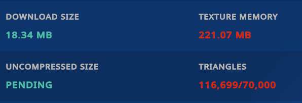
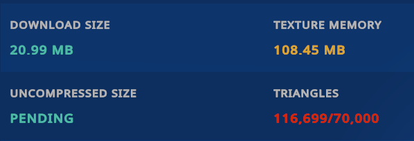
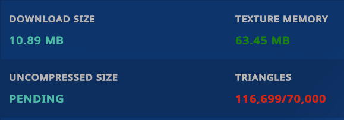
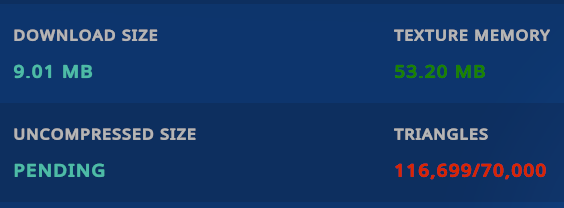

[English](README.md) | **ไทย** | [简体中文](README.zh-Hans.md)

# AvatarTuner

เครื่องมือ Optimize Texture Memory สำหรับ Avatar ใน VRChat ทำงานได้โดยตรงใน Unity Editor — โดย AvatarTuner จะช่วยวิเคราะห์ Texture ของ Avatar, วางแผนปรับเปลี่ยน Format และ Resolution อย่างปลอดภัย, สร้างไฟล์สำเนาที่ Optimize แล้ว และนำไป Apply กับ Material Reference ของ Avatar ให้ทันที โดยไม่แตะต้อง Asset ต้นฉบับของคุณแม้แต่นิดเดียว

AvatarTuner มุ่งเน้นการ Optimize **Texture Asset และ Material Reference** เท่านั้น ตัวเครื่องมือจะไม่ลดจำนวน Triangle ของ Mesh, ไม่ทำการรวม Mesh หรือ Material เข้าด้วยกัน และไม่ได้ช่วยแก้ Performance Warning ของ VRChat ไปซะทุกข้อ

## การทำงานของ AvatarTuner

1. **สแกน Avatar:** ตรวจสอบ Texture, Material, Renderer, ระบบสลับ Material ผ่าน Animation (Material Swap) และการใช้งาน Tool ยอดนิยมต่าง ๆ (Modular Avatar, VRCFury, NDMF, Avatar Optimizer, d4rkAvatarOptimizer)
2. **วางแผน (Plan):** กำหนดรูปแบบการ Optimize แยกราย Texture ตาม Preset ที่เลือก — Texture ที่ถูกป้องกันไว้ (เช่น ของ Tool อื่น หรือระบบที่ควบคุมด้วย Animation) จะไม่มีวันถูกแตะต้อง
3. **Optimize:** สร้างสำเนา Texture ที่ Optimize แล้วเก็บไว้ในโฟลเดอร์ `Assets/AvatarTuner-Generated/`
4. **นำไปใช้งาน (Apply):** นำ Material Clone ที่ Optimize แล้วไปใส่ให้กับ Renderer ของ Avatar ใน Scene โดยตรง (รองรับ Undo และคำนึงถึง Prefab Override) พร้อม Remap อนิเมชันสลับ Material ไปยัง Animation Clip และ Animator Controller ตัวก๊อปปี้ที่สร้างขึ้นใหม่ให้เสร็จสรรพ

ไฟล์ Texture, Material, Prefab, Animation Clip และ Animator Controller ต้นฉบับทั้งหมดจะ**ไม่มีการถูกดัดแปลงหรือเขียนทับใด ๆ ทั้งสิ้น**

## ฟีเจอร์เด่น

- **Preset ให้เลือก 3 แบบ** พร้อมอธิบายข้อดีและข้อแลกเปลี่ยนอย่างตรงไปตรงมา (ดูรายละเอียดด้านล่าง)
- **Apply ลง Scene ได้โดยตรง:** Avatar ใน Scene จะสลับไปใช้ Material ที่ Optimize แล้วจริง ๆ สามารถคลิกตรวจสอบใน Inspector ได้ทันทีก่อนจะกด Build
- **ตรวจจับการเปลี่ยนแปลงอัตโนมัติ (Change Detection):** หากเผลอกด Revert Material, เพิ่ม Renderer ที่ยังไม่ได้ Optimize หรือมีการแก้ไขไฟล์ต้นฉบับ ระบบจะตรวจพบและแจ้งเตือนทันที (*Changes Detected / Re-optimization Required*)
- **ย้อนกลับเป็นค่าเดิมได้ในคลิกเดียว (One-click Restore):** คืนค่า Material Reference ต้นฉบับทั้งหมดได้อย่างง่ายดาย
- **ทางเลือกเสริม Apply ตอน Build ผ่าน NDMF:** หากติดตั้ง NDMF ไว้ สามารถเลือกให้ Apply ตอนกด Build ได้ สำหรับคนที่ต้องการให้ Scene สะอาด ไม่มีการแก้ไข Object ค้างไว้
- **ตั้งค่า Override แยกราย Texture ได้:** กำหนดค่าได้อิสระ ไม่ว่าจะเป็น Exclude (ไม่แตะต้อง), Keep Resolution (คงขนาดเดิม), Keep Format (คงฟอร์แมตเดิม), Force Max Size (บังคับขนาดสูงสุด) หรือ Force Format (บังคับฟอร์แมต)
- **รองรับหลายภาษา (Localization):** สลับภาษาใช้งานได้ทันที ทั้ง English, ไทย และ 简体中文
- **โปร่งใส ไม่หลอกตา:** ข้อมูลที่มาจากการคำนวณจะระบุชัดเจนว่าเป็นค่าประมาณ (Computed Estimate) จะไม่มีการแสดงว่าเป็นผลการวัดจริง (Measured) ถ้าไม่ได้วัดจากระบบจริง ๆ

## ความเข้ากันได้ (Compatibility)

- **Unity 2022.3** (ทดสอบและยืนยันแล้วบนเวอร์ชัน 2022.3.22f1)
- **VRChat SDK Avatars (Avatars 3.0):** AvatarTuner ไม่มี Compile-time dependency ผูกติดกับ VRChat SDK
- **ทางเลือกเสริม: NDMF (`nadena.dev.ndmf`):** เปิดใช้งานขั้นตอน Apply ตอน Build อัตโนมัติ (แต่ถ้าไม่ได้ลง NDMF ไว้ ฟังก์ชัน Apply ลง Scene โดยตรงก็ยังคงทำงานได้สมบูรณ์ 100%)
- **รองรับ Optimizer ยอดนิยม:** ตรวจจับ Optimizer ยอดฮิตอย่าง AAO (Avatar Optimizer) และ d4rkAvatarOptimizer ให้อัตโนมัติ โดยระบบจะข้ามจุดที่อาจเกิดการทำงานขัดแย้งกันพร้อมขึ้นคำเตือนที่ชัดเจน แทนที่จะทำงานชนกันจนพัง

## วิธีติดตั้ง (Installation)

### วิธีที่ 1: ผ่าน VRChat Creator Companion (แนะนำ)

วิธีที่สะดวกที่สุดในการติดตั้งและรับอัปเดตอัตโนมัติ

[**➕ เพิ่มลงใน VCC (One-Click Install)**](vcc://vpm/addRepo?url=https%3A%2F%2Fawakenginexe.github.io%2FAvatarTuner%2Findex.json)

#### หรือเพิ่ม Repository ด้วยตนเอง:
1. คัดลอกลิงก์ VPM Repository ด้านล่าง:
   ```text
   https://awakenginexe.github.io/AvatarTuner/index.json
   ```
2. ใน VCC ไปที่ **Settings → Packages**
3. กดปุ่ม **Add Repository** ที่มุมขวาบน
4. วางลิงก์ที่คัดลอกมาแล้วกดยืนยัน
5. เปิดโปรเจกต์ของคุณ ไปที่หน้า **Manage Packages** ค้นหา **AvatarTuner** แล้วกด **Install**

> [!TIP]
> **การอัปเดต:** เมื่อมีเวอร์ชันใหม่ VCC จะแสดงปุ่ม **Update** ข้าง AvatarTuner ให้กดอัปเดตได้ทันที

> [!NOTE]
> **ย้ายจากการติดตั้งแบบ .unitypackage เดิม:** หากเคยติดตั้ง AvatarTuner ผ่าน `.unitypackage` มาก่อน ให้ตรวจสอบว่าไม่มีไฟล์ส่วนตัวหรือการแก้ไขโค้ดตกค้างในโฟลเดอร์ `Assets/AvatarTuner/` จากนั้นลบโฟลเดอร์ `Assets/AvatarTuner/` (และไฟล์ `.meta`) ออกก่อนเพิ่มแพ็กเกจผ่าน VCC เพื่อป้องกันข้อผิดพลาดจากไฟล์ซ้ำซ้อน ทั้งนี้ไฟล์ที่ Optimize แล้วและ Asset เดิมของ Avatar จะไม่ได้รับผลกระทบใด ๆ

---

### วิธีที่ 2: นำเข้าผ่าน Unity Package (.unitypackage)

สำหรับผู้ที่ไม่ต้องการใช้ VCC:

1. ดาวน์โหลดไฟล์ **`AvatarTuner-v1.0.0.unitypackage`** จากหน้า [GitHub Releases](https://github.com/awakenginexe/AvatarTuner/releases/latest)
2. ในโปรเจกต์ Unity ไปที่เมนู **Assets → Import Package → Custom Package…** แล้วเลือกไฟล์ที่ดาวน์โหลดมา
3. เปิดหน้าต่างเครื่องมือได้ที่เมนู **Tools → AvatarTuner**

---

### วิธีที่ 3: ผ่าน Git URL (Unity Package Manager)

1. ใน Unity ไปที่เมนู **Window → Package Manager**
2. กดปุ่ม **`+`** ที่มุมซ้ายบน แล้วเลือก **Add package from git URL…**
3. ใส่ลิงก์:
   ```text
   https://github.com/awakenginexe/AvatarTuner.git
   ```

---

โครงสร้างภายในแพ็กเกจประกอบด้วย: `Core/` (Logic หลัก), `Editor/` (หน้าต่าง UI, Scanner, Optimizer, Tracking, Application และการเชื่อมต่อ NDMF), `Editor/Localization/Translations/` (ไฟล์แปล 3 ภาษา), `package.json` และไฟล์ Assembly Definition ต่าง ๆ

## เริ่มต้นใช้งาน (Quick Start)

1. เปิดหน้าต่างเครื่องมือที่เมนู **Tools → AvatarTuner**
2. ลาก Root Object ของ Avatar จากหน้าต่าง Hierarchy มาวางในช่องใส่ Avatar (หรือกดปุ่มเลือก)
3. คลิก **Analyze Avatar** เพื่อเริ่มวิเคราะห์
4. คลิก **Optimize Avatar** → หน้าต่างตั้งค่าจะเปิดขึ้นมา: ให้เลือก Preset ที่ต้องการ, ตรวจสอบรายการที่วางแผนจะปรับแต่ง แล้วกด **Confirm & Optimize**
5. ระบบจะ Generate Texture ที่ Optimize แล้วและ Apply ลง Avatar ใน Scene ให้ทันที โดยในหน้า Overview จะแสดงสถานะตามจริง (เช่น *Optimized and Applied to Avatar*) พร้อมตัวเลข Memory และที่มาของตัวเลข (ว่ามาจากการคำนวณหรือวัดจริง)
6. หากเปลี่ยนใจหรือต้องการยกเลิก? กดปุ่ม **Restore Original Textures** ในหน้าผลลัพธ์ (Optimization Results) เพื่อสลับ Material Reference กลับเป็นของเดิมได้ทันที (ไฟล์ที่ถูกสร้างไว้จะยังคงอยู่ ไม่หาย)

## รายละเอียด Preset การ Optimize

| Preset | การทำงานและผลลัพธ์ |
| ------ | ----------------- |
| **Quality First** | เน้นความคมชัดของภาพเป็นหลัก ไม่ลด Resolution ของ Texture เด็ดขาด และจะปรับเปลี่ยนเฉพาะจุดที่ไม่ส่งผลกระทบต่อสายตาอย่างแน่นอน |
| **Balanced** *(ค่าเริ่มต้น, แนะนำ)* | จุดกึ่งกลางที่ลงตัว: ลด Texture Memory ได้เยอะพอสมควร ในขณะที่แทบมองไม่เห็นความต่างด้วยตาเปล่า (ลด Resolution ลง 1 ขั้น แต่จะไม่ลดต่ำกว่า 1024) |
| **Size First** | เน้นลด Memory ให้ได้มากที่สุดเป็นหลัก อาจส่งผลให้คุณภาพของภาพลดลงอย่างเห็นได้ชัด แนะนำให้ตรวจสอบ Texture ที่ได้รับผลกระทบเป็นรายตัวก่อนอัปโหลด |

## ภาพตัวอย่าง (Screenshots)

วัดผลจริงด้วย Performance Breakdown ของ VRChat บน Avatar ตัวเดิม (ท่าเดิม, Mesh เดิม — จำนวน 116,699 Triangles เท่ากันทุกรูป เพราะ AvatarTuner ไม่ได้ไปแตะต้องตัว Mesh แต่อย่างใด)

### Original (ก่อน Optimize)



### Quality First



### Balanced



### Size First



## ตารางเปรียบเทียบประสิทธิภาพและขนาด (Performance & Size Comparison)

วัดผลบน Avatar ตัวเดียวกันด้วย Performance Breakdown ของ VRChat (ตัวเลขตรงตามที่ VRChat แสดงทุกประการ):

| Preset | VRChat Texture Memory (MB) | VRChat Download Size (MB) | ลด Texture Memory ได้ | ลด Download Size ได้ | หมายเหตุด้านคุณภาพของภาพ |
| ------ | --- | --- | --- | --- | ------------------------ |
| Original | 221.07 | 18.34 | — | — | ค่ามาตรฐานเริ่มต้น (Baseline) |
| Quality First | 108.45 | 20.99 | 50.9 % | −14.4 % *(ใหญ่ขึ้น)* | คง Resolution เดิมไว้ทั้งหมด; ขนาด Download Size อาจเพิ่มขึ้นเล็กน้อย เนื่องจาก Format ที่ใช้รักษาคุณภาพจะถูกบีบอัดน้อยกว่า |
| Balanced | 63.45 | 10.89 | 71.3 % | 40.6 % | แทบมองไม่เห็นความต่างในการใช้งานทั่วไป |
| Size First | 53.20 | 9.01 | 75.9 % | 50.9 % | ลดขนาดได้เยอะที่สุด; ไม่ได้ประเมินคุณภาพของภาพแยกเป็นจุด ๆ — แนะนำให้ตรวจสอบ Texture ที่ถูกแจ้งเตือนก่อนอัปโหลด |

สูตรที่ใช้คำนวณเปอร์เซ็นต์การลดลง (คำนวณแยกแต่ละคอลัมน์):
`Reduction (%) = (Original − Optimized) / Original × 100`

*ผลลัพธ์อาจแตกต่างกันไปตามโมเดล Avatar, ชนิดของ Texture, Shader ที่ใช้ และการตั้งค่าต่าง ๆ ตัวเลขเหล่านี้เป็นการทดสอบบน Avatar จริงหนึ่งตัวเท่านั้น ไม่ได้การันตีว่าจะได้ตัวเลขนี้เท่ากันในทุก Avatar*

### ทำไมตัวเลขที่ AvatarTuner แสดง ถึงต่างจากที่ VRChat แสดง?

AvatarTuner คำนวณ Texture Memory ใน Unity Editor จากข้อมูล Asset และการตั้งค่าที่ทำการ Optimize โดยค่าเหล่านี้คือ **ค่าประมาณ (Estimate)** ซึ่งอาจมีความแตกต่างจาก Performance Breakdown ของ VRChat ได้ เนื่องจาก VRChat มีการประมวลผล Texture Format เฉพาะแพลตฟอร์ม, การสร้าง Mipmap, การบีบอัดตอน Build, Asset Reference และ Pipeline การ Build ของ VRChat เอง นอกจากนี้ **Download Size** และ **GPU Texture Memory** เป็นค่าคนละตัวกัน หากต้องการตัวเลขที่แม่นยำที่สุด แนะนำให้ดูจากหน้าต่าง Build ของ VRChat จริง

รายละเอียดเพิ่มเติม:

- AvatarTuner คำนวณ GPU Texture Memory จากขนาดกว้าง×ยาว (Dimensions), Format, Mipmap chain และข้อมูลการ Optimize ที่ประมวลผลจริง
- ส่วน VRChat จะวัดและรายงานผลจากการวิเคราะห์ Avatar หลังผ่านกระบวนการ Build บนสภาพแวดล้อม (Runtime/Build environment) ของทาง VRChat เอง
- ตัวแปรอื่น ๆ เช่น Platform Override, รูปแบบ Compression, Mipmap, Material Reference ที่เรียกใช้ผ่าน Animation และ Optimizer ตัวอื่น ๆ ที่ทำงานตอน Build ล้วนส่งผลให้ตัวเลขสุดท้ายเปลี่ยนแปลงได้
- ค่า GPU Texture Memory ที่คำนวณใน Unity Editor **ไม่ใช่** Download Size
- ขนาดไฟล์บนดิสก์ของ Texture ที่ Generate ออกมา **ไม่ใช่** Texture Memory ใน VRChat
- ค่าที่ระบุว่าเป็นตัวเลขจาก VRChat จะใช้เฉพาะค่าที่วัดได้จาก VRChat จริง ๆ เท่านั้น (เหมือนในตารางด้านบน) ส่วนค่าที่แสดงในหน้าต่าง AvatarTuner จะระบุชัดเจนว่าเป็นค่าประมาณจากการคำนวณ (Computed Estimate)

## ข้อจำกัดที่ควรรู้ (Known Limitations)

- การ Apply ลงตรง ๆ ต้องทำกับ Avatar ที่เป็น **Scene Object** (วางเป็น Prefab Instance อยู่ใน Scene) เท่านั้น หากไปเลือกไฟล์ Prefab จากหน้าต่าง Project ระบบจะทำแค่ Generate ไฟล์ออกมาให้ แต่จะไม่ Apply ลง Prefab (เพื่อป้องกันไม่ให้ Asset ต้นฉบับถูกแก้ไข)
- Animation สลับ Material จะถูก Remap ลงบน Animation Clip และ Controller ตัวก๊อปปี้ที่สร้างขึ้นใหม่เฉพาะเมื่อ Clip และ Controller นั้นเป็น Asset จริงเท่านั้น หากมี Reference ส่วนไหนที่ไม่สามารถ Remap ได้อย่างปลอดภัย ระบบจะคง Asset ต้นฉบับไว้ตามเดิม และจะขึ้นเตือนสถานะของ Avatar เป็น **Partially Optimized** ให้เห็นชัดเจน (ไม่มีการแอบข้ามเงียบ ๆ แน่นอน)
- หากตรวจพบคอมโพเนนต์จาก Optimizer ตัวอื่น (เช่น คอมโพเนนต์ของ AAO หรือ d4rkAvatarOptimizer บน Avatar) ระบบจะข้ามขั้นตอนที่มีโอกาสขัดแย้งกันพร้อมแจ้งเตือนให้ทราบ
- การตรวจจับการเปลี่ยนแปลง (Change Detection) จะทำงานเมื่อ: มีการเลือก Avatar, เปิดหน้าต่างเครื่องมือ, กด Refresh, วิเคราะห์ (Analysis) และ Optimize เท่านั้น — ไม่ได้รันเช็กทุก Editor Frame ให้เปลืองทรัพยากร
- AvatarTuner **ไม่ลด**จำนวน Triangle, ไม่ลดจำนวน Mesh และไม่รวม Material Slot

## การย้อนกลับไปใช้ Texture เดิม (Restore)

ในหน้า Optimization Results → กดปุ่ม **Restore Original Textures** ช่อง Material ทุกช่องของ Renderer จะสลับกลับไปใช้ Material ต้นฉบับเดิม และ Animator ก็จะกลับไปใช้ Controller เดิมทันที (รองรับ Undo; และไฟล์ที่ Generate ไว้จะยังคงถูกเก็บไว้เผื่อต้องการกด Apply ใหม่อีกครั้ง) เนื่องจาก Asset ต้นฉบับไม่เคยถูกแก้ไข หากต้องการลบไฟล์ที่สร้างขึ้นทิ้งทั้งหมด ก็สามารถกดปุ่ม **Clean Up Generated Files** ได้อย่างปลอดภัย

## ความปลอดภัยในการใช้งาน (Safety Guarantees)

- **ไม่แตะต้องไฟล์เดิม:** Texture, Material, Prefab, Animation Clip และ Controller ต้นฉบับจะไม่มีวันถูกแก้ไขหรือเขียนทับ
- **จัดการไฟล์เป็นระเบียบ:** ทุกอย่างที่ AvatarTuner สร้างขึ้น จะเก็บไว้ใต้โฟลเดอร์ `Assets/AvatarTuner-Generated/` เท่านั้น และมีการติดตามประวัติด้วย Manifest (`avatartuner-manifest.json`) พร้อม Hash และข้อมูลที่มาอย่างครบถ้วน
- **ไม่มีการทำงานเบื้องหลังโดยไม่บอก:** การ Optimize จะต้องผ่านขั้นตอนตรวจสอบและกดยืนยัน (Review & Confirm) เสมอ จะไม่มีอะไรแอบรันเองอัตโนมัติ
- **ระบบ Rollback เมื่อเกิดข้อผิดพลาด:** หากขั้นตอนการ Apply ล้มเหลว ระบบจะย้อนการเปลี่ยนแปลงใน Scene ทั้งหมดกลับเป็นค่าเดิมทันที และ Manifest จะไม่มีการบันทึกสถานะว่าสำเร็จหากงานยังไม่เรียบร้อยจริง

## เครดิตและ Third-Party Notices

ดูรายละเอียดเพิ่มเติมได้ที่ [THIRD_PARTY_NOTICES.md](THIRD_PARTY_NOTICES.md): AvatarTuner ถูกพัฒนาขึ้นมาใหม่เองทั้งหมด (Original Implementation) รองรับการเชื่อมต่อกับ NDMF (`nadena.dev.ndmf`, MIT) แบบทางเลือกเมื่อมีการติดตั้งไว้ และตรวจจับ Tool อื่นด้วยชื่อเท่านั้น (Modular Avatar, VRCFury, Avatar Optimizer และ d4rkAvatarOptimizer) โดยไม่มีการ Bundle Source Code ของบุคคลที่สามใด ๆ รวมเข้ามาในแพ็กเกจ

## License

[MIT](LICENSE) — Copyright (c) 2026 Awake Ngine XE.

## ช่องทางติดต่อและลิงก์อื่น ๆ

- Repository: <https://github.com/awakenginexe/AvatarTuner>
- เว็บไซต์ผู้พัฒนา: <https://awakenginexe.com/>
