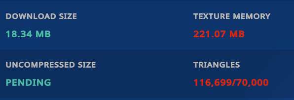
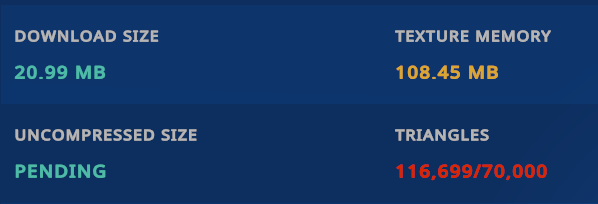
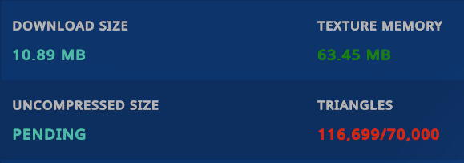
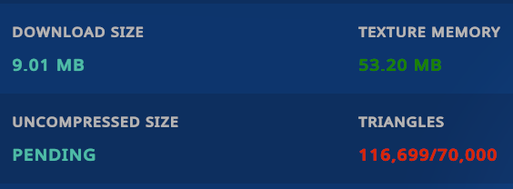

[English](README.md) | [ไทย](README.th.md) | **简体中文**

# AvatarTuner

在 Unity Editor 内为 VRChat 模型优化纹理显存。AvatarTuner 会分析模型的纹理、规划安全的格式与分辨率变更、生成优化副本，并将其应用到模型自身的材质引用上 —— 全程绝不改动你的原始资源。

AvatarTuner 优化的是**纹理资源与材质引用**。它不会减少网格三角面数，不会合并网格或材质，也不会解决所有 VRChat 性能警告。

## AvatarTuner 的功能

1. 扫描模型：纹理、材质、渲染器、由动画驱动的材质切换，以及第三方工具使用情况（Modular Avatar、VRCFury、NDMF、Avatar Optimizer、d4rkAvatarOptimizer）。
2. 规划：按预设策略逐纹理决策 —— 受保护的纹理（第三方工具、动画驱动系统）绝不被触碰。
3. 优化：将优化后的纹理副本生成到 `Assets/AvatarTuner-Generated/`。
4. 应用：把优化后的材质克隆分配给场景中模型的渲染器（记录 Undo、感知预制体实例覆盖），并把材质切换动画重映射到生成的剪辑与控制器副本上。

原始纹理、材质、预制体、动画与动画控制器永远不会被修改。

## 核心特性

- 三种优化预设，并如实说明各自的权衡（见下文）。
- 直接场景应用：场景中的模型真实地引用优化后的材质；构建前即可在 Inspector 中检查。
- 自动变更检测：还原材质、新增未优化渲染器或编辑源资源都会被检测并报告（检测到变更 / 需要重新优化）。
- 一键还原原始材质引用。
- 可选的构建期应用（需安装 NDMF），适合不希望改动场景的用户。
- 逐纹理覆盖：排除、保持分辨率、保持格式、强制最大尺寸、强制格式。
- 本地化：English、ไทย、简体中文，可即时切换。
- 完全透明：估算值始终标注为"计算估算值"；只有真正实测的数据才会标注为实测。

## 兼容性

- **Unity 2022.3**（已在 2022.3.22f1 上验证）。
- VRChat SDK 模型（Avatars 3.0）。AvatarTuner 在编译期不依赖 VRChat SDK。
- 可选：**NDMF**（`nadena.dev.ndmf`）提供构建期应用。未安装 NDMF 时，直接场景应用功能完整可用。
- 已知优化器（AAO / d4rkAvatarOptimizer）会被检测；存在冲突的变换会被跳过并给出可操作的警告，而不是互相争抢。

## 安装

AvatarTuner 是 Unity 包（UPM）。任选一种方式：

- **VRChat Creator Companion（推荐）：** 添加 AvatarTuner 的 VPM 仓库，然后将包安装到你的项目中：
  1. 打开 VRChat Creator Companion。
  2. 前往 **Settings → Packages**。
  3. 点击 **Add Repository**。
  4. 粘贴 AvatarTuner 仓库地址：`https://awakenginexe.github.io/AvatarTuner/index.json`
  5. 确认添加仓库。
  6. 打开目标 VRChat 项目。
  7. 在 **Manage Packages** 中找到 **AvatarTuner** 并安装。

  添加仓库只是让 AvatarTuner 变为可用状态——你仍需手动将它安装进具体项目。（该仓库地址将在首次公开发布后生效。）

  **通过 VCC 更新：** 有新版本时 VCC 会提示；打开项目，在 Manage Packages 中点击 AvatarTuner 旁的 **Update** 即可。

  **从此前的 .unitypackage 安装迁移：** 若此前通过 `.unitypackage` 安装过 AvatarTuner，请先确认 `Assets/AvatarTuner/` 目录内无个人资产或自定义修改，随后在通过 VCC 添加包前手动删除 `Assets/AvatarTuner/` 目录及其 `.meta` 文件，以避免文件与程序集重复冲突。模型引用与已生成的优化资产均不受影响。
- **下载最新发布版本（.unitypackage）：** 从 [GitHub Releases](https://github.com/awakenginexe/AvatarTuner/releases/latest)
  获取文件，打开你的 Unity 项目，然后 **Assets → Import Package → Custom Package…**
  并选择该文件。之后通过 **Tools → AvatarTuner** 打开 AvatarTuner。
- **Git URL：** Window → Package Manager → `+` → *Add package from git URL…* →
  `https://github.com/awakenginexe/AvatarTuner.git`
- **手动：** 将本仓库内容复制到项目的 `Packages/AvatarTuner/` 目录（或 `Assets/` 下）。

包内容：`Core/`（纯逻辑）、`Editor/`（窗口、扫描器、优化器、追踪、应用、NDMF 集成）、`Editor/Localization/Translations/`（三种语言）、`package.json` 以及程序集定义文件。

## 快速上手

1. 打开 **Tools → AvatarTuner**。
2. 将模型根节点从 Hierarchy 拖入模型区域（或使用对象选择器）。
3. 点击 **Analyze Avatar**。
4. 点击 **Optimize Avatar** → 打开配置对话框：选择预设、审查计划变更，然后点击 **Confirm & Optimize**。
5. 优化纹理会被生成并应用到场景模型上。Overview 会如实显示状态（例如"已优化并应用至模型"）以及显存数字及其数据口径（计算值或实测值）。
6. 想反悔？在优化结果页点击 **Restore Original Textures** 即可还原材质引用（生成的文件会保留）。

## 优化预设

| 预设 | 行为 |
| ---- | ---- |
| **画质优先（Quality First）** | 视觉保真度优先。绝不降低分辨率；仅允许视觉上不可见的变更。 |
| **平衡模式（Balanced）**（默认，推荐） | 折中方案：在保持差异难以察觉的前提下显著降低纹理显存（分辨率下调一档，且不低于 1024）。 |
| **容量优先（Size First）** | 优先最大化降低显存占用；画质可能出现可见下降。上传前请逐一检查受影响的纹理。 |

## 截图

使用 VRChat 自带的 Performance Breakdown 在同一模型上实测（姿态相同、网格相同 —— 每张截图均为 116,699 个三角面；AvatarTuner 不改动任何网格）。

### Original

### Quality First

### Balanced

### Size First

## 性能与体积对比

在同一模型上使用 VRChat Performance Breakdown 实测（数值与 VRChat 显示的完全一致）：

| 预设 | VRChat 纹理显存 (MB) | VRChat 下载大小 (MB) | 纹理显存缩减 | 下载大小缩减 | 画质说明 |
| ---- | --- | --- | --- | --- | ---------- |
| Original | 221.07 | 18.34 | — | — | 基准 |
| Quality First | 108.45 | 20.99 | 50.9 % | −14.4 %（增大） | 分辨率不变；由于保真格式压缩更少，下载大小可能略微上升 |
| Balanced | 63.45 | 10.89 | 71.3 % | 40.6 % | 正常使用中差异难以察觉 |
| Size First | 53.20 | 9.01 | 75.9 % | 50.9 % | 降幅最大；画质差异未单独评估——上传前请审查被标记的纹理 |

缩减率计算公式（每列独立计算）：
`缩减率 (%) = (原始值 − 优化值) / 原始值 × 100`

优化效果因模型、纹理、Shader 与具体配置而异。以上数字来自一个真实模型，不构成对其它模型的承诺。

### 关于 AvatarTuner 与 VRChat 测量差异的重要说明

AvatarTuner 根据资源数据与优化设置计算纹理显存。这些数值是估算值，可能因平台特定的纹理格式、mipmap、压缩、资源引用以及构建期处理而与 VRChat 的 Performance Breakdown 存在出入。下载大小与 GPU 纹理显存是两种不同的度量。如需最准确的对比，请查看 VRChat 中实际构建的模型。

详细说明：

- AvatarTuner 根据纹理尺寸、格式、mipmap 链以及实际处理过的优化数据来计算 GPU 纹理显存。
- VRChat 的数值来自其自身对已构建模型在其构建/运行时环境中的分析。
- 平台特定的纹理覆盖、压缩格式、mipmap、动画驱动或额外的材质引用，以及其它构建期优化工具，都可能影响最终数值。
- Editor 中计算出的 GPU 纹理显存**不等于**下载大小。
- 生成的纹理资源的磁盘占用**不等于** VRChat 纹理显存。
- 只有真实的 VRChat 实测数据（如上表）才会被呈现为 VRChat 结果；AvatarTuner 在 Editor 内的数值始终标注为计算估算值。

## 已知局限性

- 直接应用要求模型是**场景中的对象**（场景中的预制体实例可以）；若从 Project 窗口选中预制体资产，则只生成输出而不应用（应用会修改源资产）。
- 当剪辑与控制器是真实资产时，材质切换动画会被重映射到生成的副本上。无法安全重映射的引用将保留原始资源，且模型会被标记为**部分优化**——绝不静默跳过。
- 检测到优化器冲突（模型上存在 AAO / d4rkAvatarOptimizer 组件）时，会跳过冲突的变换并给出警告。
- 变更检测在选择模型、打开窗口、刷新、分析与优化时执行——不会在每个 Editor 帧运行。
- AvatarTuner 不会减少三角面数、网格数量或材质槽数量。

## 还原原始纹理

优化结果页 → **Restore Original Textures**。每个渲染器槽位都会还原为原始材质，动画控制器也恢复为原始控制器（已记录 Undo；生成的文件会保留以便日后再次应用）。你的原始资产从未被修改，因此也可以通过 **Clean Up Generated Files** 彻底清理。

## 安全性保障

- 原始纹理、材质、预制体、动画与控制器绝不被修改。
- AvatarTuner 生成的所有内容都位于 `Assets/AvatarTuner-Generated/`，并在清单（`avatartuner-manifest.json`）中以哈希与来源信息全程追踪。
- 优化必须经过明确的审查与确认步骤；不会自动执行任何操作。
- 应用失败时会回滚场景中的更改；清单绝不会记录未实际发生的成功。

## 致谢与第三方声明

请参阅 [THIRD_PARTY_NOTICES.md](THIRD_PARTY_NOTICES.md)：AvatarTuner 为完全原创实现。在安装 NDMF（`nadena.dev.ndmf`，MIT 许可）时可选集成；对 Modular Avatar、VRCFury、Avatar Optimizer 与 d4rkAvatarOptimizer 仅按名称进行检测。未打包任何第三方源代码。

## 开源许可证

[MIT](LICENSE) — Copyright (c) 2026 Awake Ngine XE

## 相关链接

- 仓库：<https://github.com/awakenginexe/AvatarTuner>
- 开发者：<https://awakenginexe.com/>
